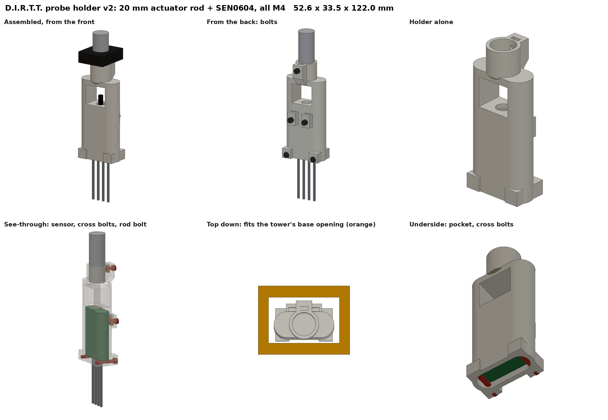

# Probe holder

| File | What it is |
|---|---|
| `DIRTT_probe_holder_v2.stl` | **Current.** Fits the real actuator's 20 mm rod; the sensor is held by M4 bolts |
| `DIRTT_probe_holder.stl` | v1: 12.4 mm socket (made for the mock actuator); split clamp too stiff to close in PLA |
| `make_probe_holder_v2.py` | Makes v2 (`pip install trimesh manifold3d shapely`) |
| `DIRTT_probe_holder_v2_preview.png` | Views with the sensor, rod and bolts |

## v2

- **Rod socket:** 20.4 mm bore, 21 mm deep.
  - The rod shows 24 mm when fully retracted, so 3 mm stays clear of the actuator's end cap.
  - The rod tip pushes on the socket floor when the probe goes down.
  - On the way up, an M4 bolt pulls it: the bolt goes in from the clamp side of the socket and its
    tip enters the rod's 6 mm cross-hole, 14.5 mm from the rod tip.
- **Sensor:** same pocket cross-section as v1 (45.6 × 15.6 mm), which fits the SEN0604.
  - v1 only covered the top 30 mm of the 60 mm body. v2's sleeve covers all of it, so the bolts
    can sit under the body's real bottom face.
  - **Two M4 cross bolts** run under the ends of the sensor body, clear of the four pins. It can't
    slide out when the probe is pulled out of the soil, and this doesn't rely on friction.
  - **Two M4 pinch bolts** press it against the far wall so it doesn't rattle.
- **Size:** 52.6 × 33.5 mm across, 122 mm tall. It fits through the tower's base opening (62 × 40 mm) with at
  least 1.2 mm to spare on every side; the narrowest gap is at the socket.
- All bolt heads are on the same side as the tower's clamp, not the spine side, so you can reach
  them in the tower.

### Hardware per holder (all M4)

| Qty | Part | Job |
|---|---|---|
| 1 | M4 × 16 bolt + M4 nut | rod pin |
| 2 | M4 × 25 bolt (no nut) | cross bolts under the sensor; they cut their own thread in the far wall |
| 2 | M4 × 12–16 bolt + M4 nut | pinch bolts |

### Assembly

1. Drop the three M4 nuts into their slots from the top: one behind the socket, two above the
   pinch-bolt holes.
2. Feed the sensor cable up through the 12 mm hole in the pocket ceiling and out the window. Push
   the sensor up into the pocket.
3. Fit the two M4 × 25 cross bolts from the clamp side, under the sensor. Screw them in until the
   heads sit in their counterbores; the far wall's holes are undersized, so they thread themselves.
4. Tighten the pinch bolts until the sensor stops moving. **Snug, not hard**: they press on the
   sensor's plastic case.
5. Slide the holder onto the rod with the rod's cross-hole facing the rod bolt's hole. Screw the
   M4 × 16 in through the nut until the head seats. The tip is then in the rod's hole.

### Printing

- **Orientation:** upright, as the STL sits: skirt down, socket up. No supports; the block behind
  the socket has a 45° underside.
- **Walls:** 5 or more, and 40–60 % infill. Walls carry the load around the bolts.
- **Material:** PETG if you have it.

### Assumptions

These come from photos and the old models:
- The actuator sits in the tower with its motor beside the tube along the tower's width, like the
  mock. Then the rod's cross-hole points toward the clamp side. If yours is turned 90°, the rod
  bolt won't line up: say so, and it's a two-line change in the script.
- Rod hole center 14.5 mm from the rod tip (24 mm showing, minus 6.5 mm to the hole's far edge,
  minus the 3 mm radius).
- The sensor's outer pins are within 13 mm of center. The cross bolts sit 19 mm out.
- The sensor body is 60 mm tall, with the same 45.6 × 15.6 mm cross-section all the way down,
  and the cable coming out of the top center. If the lower half is narrower, the cross bolts
  (19 mm out) may miss its ends: measure it.
