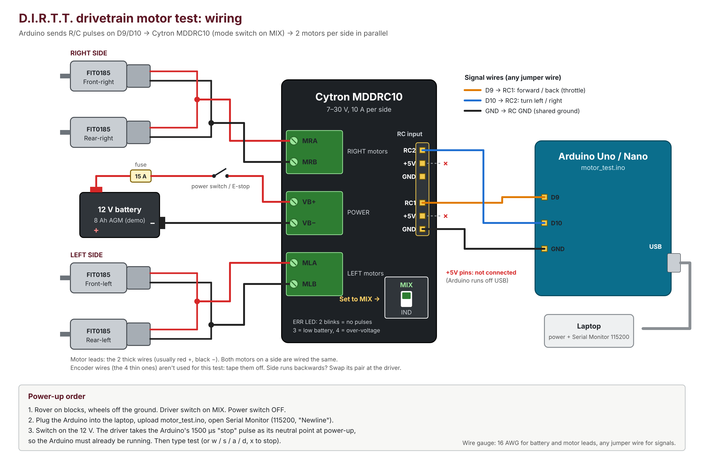

# Drivetrain motor test (Arduino → MDDRC10)

Drives the four FIT0185 gearmotors through the Cytron MDDRC10 from an Arduino, standing in for the
flight controller. The MDDRC10 reads R/C servo pulses: 1500 µs = stop, ±435 µs = full speed.

## Wiring
| Arduino | MDDRC10 |
|---|---|
| D9 | RC1 signal (forward / back) |
| D10 | RC2 signal (turn) |
| GND | RC GND |
| — | RC +5V: **not connected** (the Arduino runs off USB) |

Motors: both right motors in parallel on **MRA/MRB**, both left motors on **MLA/MLB**. Battery
through a 15 A fuse and the power switch / E-stop to **VB+/VB−**. Mode switch on **MIX**.
`make_wiring.py` regenerates `wiring.svg`.

## Run it
1. Rover on blocks, wheels off the ground. Driver switch on MIX. 12 V off.
2. Upload `motor_test.ino` (Uno, Nano or Mega; uses the built-in Servo library).
3. Serial Monitor: **115200** baud, line ending **Newline**.
4. Switch on the 12 V. The driver captures the Arduino's 1500 µs pulse as "stop" at power-up, so
   the Arduino has to be running first.
5. Type `test` and watch each wheel. Or drive by hand:

| Command | Does |
|---|---|
| `w` / `s` | forward / reverse |
| `a` / `d` | pivot left / right |
| `x` | stop now |
| `speed 40` | speed for w/s/a/d (default 30 %) |
| `time 3` | seconds before a move stops itself (default 2, `0` = until `x`) |
| `t 50 -20` | raw throttle and steering, −100..100 % |
| `mode ind`, then `l 40` / `r -40` | one side at a time (driver switch on **IND**, re-powered) |
| `?` / `h` | status / help |

Speed changes are ramped (about 0.5 s to full) so the motors don't slam. Any key aborts `test`.

## Reading the result
- **A whole side runs backwards:** swap that side's pair at the driver (MLA↔MLB or MRA↔MRB).
- **One wheel of a side disagrees with the other:** swap that motor's two wires.
- **Pivots the wrong way:** swap D9/D10, or the two sides' pairs.
- **ERR LED blinks 2×:** no pulses (check D9/D10/GND). **3×:** battery low. **4×:** over-voltage.
- **OC LED on:** a motor is stalled or binding.
